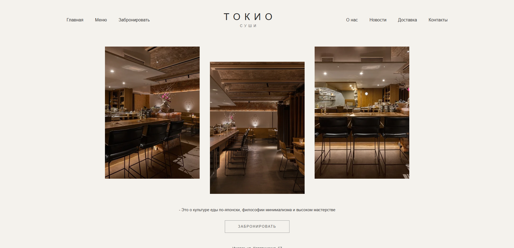
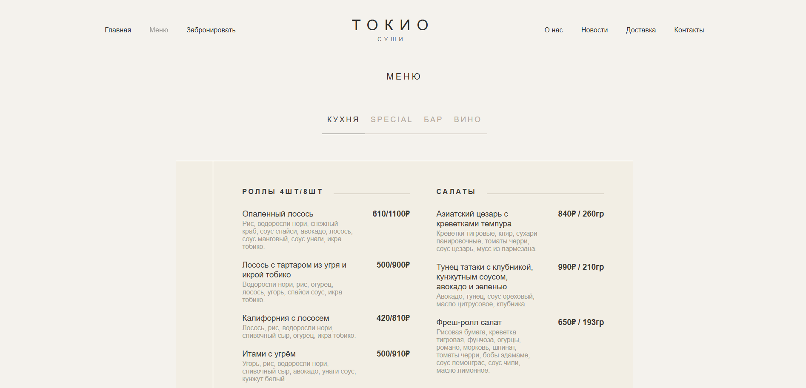
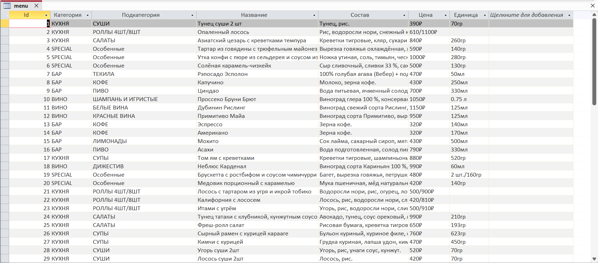
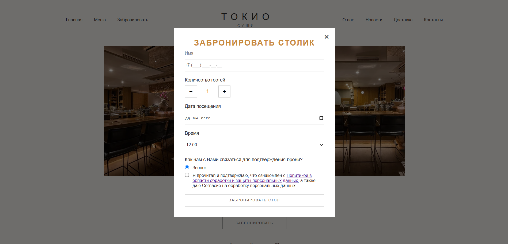
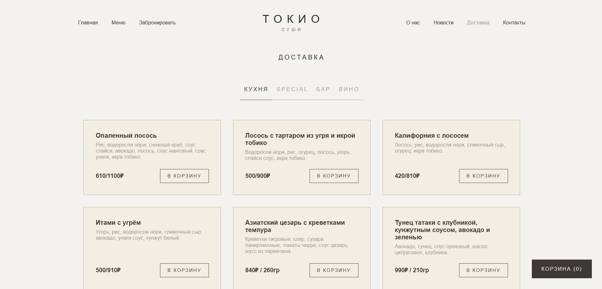
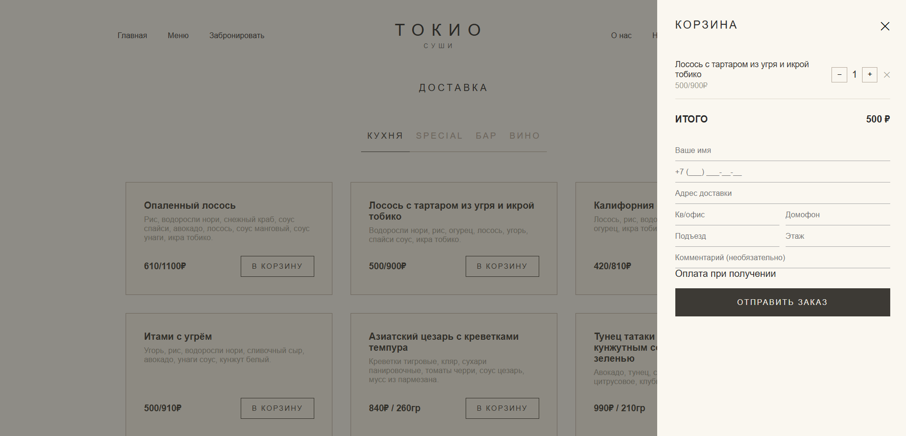
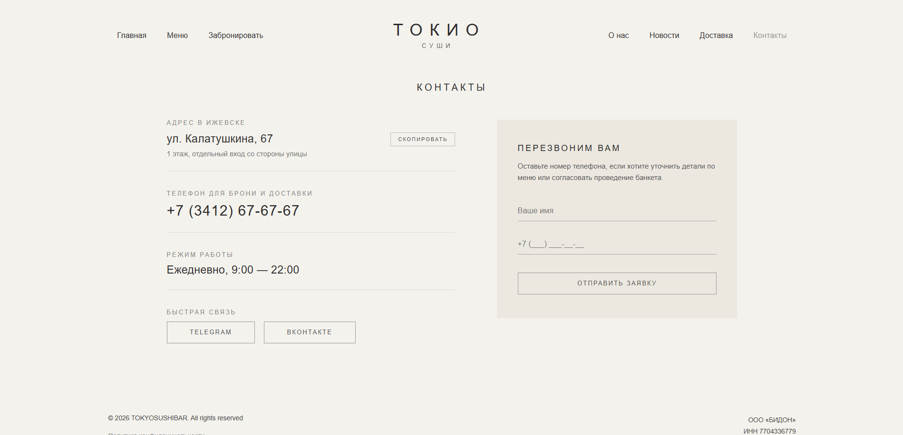
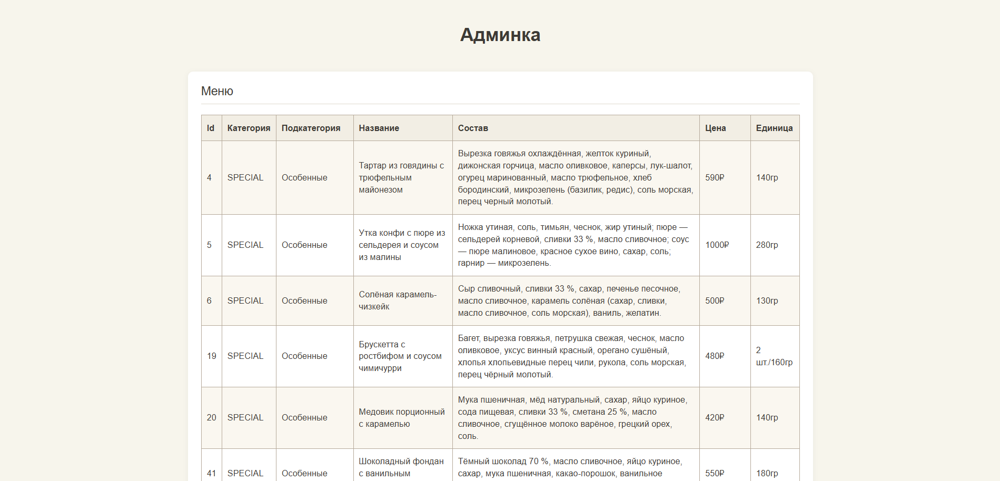
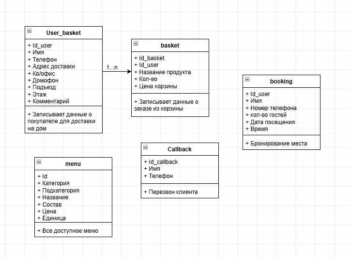

# ТОКИО СУШИ

Суши бар оказывает услуги по заказу из кухни в ресторане и доставляет заказы из ресторана на дом. Клиенты обращаются в ресторан за приятным время провождения, насытить свой желудок. Каждый клиент при бронировании столика через сайт заполняет: имя (на чье заказывать столик), номер телефона, количество гостей (сколько придет в суши-бар), дата посещения, время и подтверждение, что согласен с политикой конфиденциальности ресторана. При любых вопросах клиент может оставить на сайте свой номер телефона и в течении 3–5 мин. админ перезвонит.

---

## Что есть

- **Главная:** все ниже перечисленные вкладки, кроме корзины (она в форме "доставка") и админки (чтоб не была доступна обычному пользователю).
- **Меню с разделами** (КУХНЯ, SPECIAL, БАР, ВИНО).
- **Забронировать:** бронь столика с открытием формы оформления (имя, номер телефона, кол-во гостей, дата посещения, время и согласие с политикой конфидициальностью).
- **О нас:** просмотр описания о суши-баре.
- **Новости:** события в суши-баре.
- **Доставка:** карточки блюд, вкладки, кнопка "В корзину".
- **Корзина:** добавление, изменение количества, форма оформления заказа. Заказ уходит на сервер и сохраняется в Access.
- **Контакты:** информация о местоположении, номере телефона и режиме работы суши-бара. Обратный звонок для вопросов клиента.
- **Админка:** просмотр всех таблиц из базы. 

---

## Как это выглядит

***Главная:***

Весь визуал страниц для обычного пользователя.

***Страница меню с разделами:***

Все меню, доступное в суши-баре, оно находится в БД Accsess. При изменении данных в БД, они сразу изменяются в вкладке "меню" и вкладке "доставка".

***Меню, добавление новой позиции в суши-бар:***

Добавление новых позиций происходит вручную, через БД Accsess. После любых изменений данные сразу обновляются на сайте.

***Страница бронирования столика:***

Эта страница всплывает и открывается абсолютно везде, на каждой вкладке. Здесь идет бронирование столика.

***Страница доставки с карточками и вкладками:***

Всё меню, что доступно в суши-баре для заказа еды на дом.

***Корзина + форма оформления:***

Для оформления заказа, надо закинуть хоть 1 позицию в корзину, после нажатия на кнопку "Корзина", всплывёт окно с всеми выбранными позициями и заполнение данных для доставки.

***Контакты + обратный звонок:***

Информация о место положении суши-бара, номер телефона, режим работы и форма "Перезвоним вам".

***Админка с таблицами:***

Админ панель для просмотра данных о клиенте и всем меню в суши-баре. Для входа в админку в адресной строке вручную ввести /admin15095.

---

## Как запустить

1. Сделать пустой Python проект.
2. Скачать из главной директории project sushi bar.rar и перенести в свой проект.
3. Установить Python библиотеки: pip install flask pyodbc
4. Запустить: `python app.py`.
5. Открыть в браузере: http://localhost:5000

---

### Структура

### Учебный проект для техникума.
